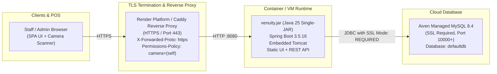

# Venuity Cloud Deployment Guide

This guide details how to deploy the unified **Venuity** single-JAR application (`venuity.jar`) to free-tier cloud infrastructure using **Managed MySQL** (such as Aiven Free Tier) and a containerized hosting platform (**Render Free Web Service**) or an **Oracle Cloud Always Free VM**.

---

## 1. Architecture Overview



---

## 2. Cloud Database Setup: Aiven Free MySQL

Aiven offers a free cloud MySQL service with 5 GB storage, automatic SSL enforcement, and automated backups.

### Step-by-Step Provisioning:
1. Sign up for a free account at [aiven.io](https://aiven.io/).
2. Click **Create Service** → Select **MySQL** (version 8.4 or latest).
3. Select the **Free Tier** plan and choose a cloud region close to your users (e.g., Frankfurt, Oregon, Mumbai).
4. Name your service (e.g., `venuity-mysql`) and click **Create Service**.
5. Once active, view your **Service Overview** and note the connection parameters:

| Aiven Connection Parameter | Maps to Venuity Environment Variable | Notes |
| :--- | :--- | :--- |
| **Host** | `DB_HOST` | e.g., `mysql-3a1b2c-myproject.aivencloud.com` |
| **Port** | `DB_PORT` | e.g., `12345` (Aiven assigns unique ports) |
| **User** | `DB_USER` | Typically `avnadmin` |
| **Password** | `DB_PASSWORD` | Strong password generated by Aiven |
| **Database** | `DB_NAME` | Default is `defaultdb` |
| **SSL Mode** | `DB_SSL_MODE` | Set to `REQUIRED` |
| **Connection Pool** | `DB_POOL_SIZE` | Set to `5` for free tier |

> [!IMPORTANT]
> Aiven MySQL mandates SSL connections. Venuity's `prod` profile defaults `DB_SSL_MODE` to `REQUIRED`, ensuring encrypted transit without requiring custom CA certificate installations for public certificates.

---

## 3. Option A: Deploy to Render (Free Docker Web Service)

Render provides free Docker-based Web Services with automatic HTTPS, continuous deployment from GitHub, and health checks.

### Prerequisites:
- A GitHub repository containing the Venuity codebase.
- A free Render account at [render.com](https://render.com/).

### Deployment Steps:
1. In the Render Dashboard, click **New +** → **Web Service**.
2. Connect your GitHub repository.
3. Configure the service settings:
   - **Name:** `venuity`
   - **Language / Runtime:** `Docker`
   - **Branch:** `main` (or your target branch)
   - **Dockerfile Path:** `./Dockerfile`
   - **Plan:** **Free** (512 MB RAM, 0.1 CPU)
   - **Health Check Path:** `/api/health`
4. Expand **Advanced** → **Environment Variables**, and add the following:

| Environment Variable | Value | Classification |
| :--- | :--- | :--- |
| `SPRING_PROFILES_ACTIVE` | `prod` | Config |
| `DB_HOST` | `<aiven-host>` | Secret |
| `DB_PORT` | `<aiven-port>` | Secret |
| `DB_NAME` | `defaultdb` | Secret |
| `DB_USER` | `avnadmin` | Secret |
| `DB_PASSWORD` | `<aiven-password>` | Secret |
| `DB_SSL_MODE` | `REQUIRED` | Config |
| `DB_POOL_SIZE` | `5` | Config |
| `JWT_SECRET` | `<32+ random base64 bytes>` | Secret |
| `BOOTSTRAP_ADMIN_USER` | `admin` | Config |
| `BOOTSTRAP_ADMIN_PASSWORD` | `<strong-admin-passphrase>` | Secret |
| `SPRINGDOC_API_DOCS_ENABLED`| `false` | Config |
| `SPRINGDOC_SWAGGER_UI_ENABLED`| `false` | Config |

> [!TIP]
> Generate a cryptographically secure 256-bit JWT secret using:
> ```bash
> openssl rand -base64 48
> ```

5. Click **Create Web Service**.
6. Render builds the multi-stage Docker image, runs the non-root container, executes Flyway migrations, and verifies `/api/health`.
7. Your app is live at `https://<service-name>.onrender.com`.

> [!NOTE]
> **Free Tier Sleep Behavior:** Render free web services spin down after 15 minutes of inactivity. The first incoming request will take ~30–45 seconds to spin up (cold start). Once awake, subsequent requests respond in milliseconds.

---

## 4. Option B: Deploy to Oracle Cloud Always Free VM

Oracle Cloud Infrastructure (OCI) offers an **Always Free** tier with up to 4 Ampere A1 ARM compute cores and 24 GB RAM (or 2 AMD x86 micro instances).

### Step 1: Install Java 25 Runtime on the VM
```bash
sudo apt update && sudo apt install -y curl tar
curl -OL https://github.com/adoptium/temurin25-binaries/releases/download/jdk-25%2B01/OpenJDK25U-jre_x64_linux_hotspot_25_01.tar.gz
sudo mkdir -p /usr/lib/jvm/temurin-25
sudo tar -xzf OpenJDK25U-jre_x64_linux_hotspot_25_01.tar.gz -C /usr/lib/jvm/temurin-25 --strip-components=1
sudo update-alternatives --install /usr/bin/java java /usr/lib/jvm/temurin-25/bin/java 1
java -version
```

### Step 2: Set up User and Application Directory
```bash
sudo useradd -r -s /bin/false -d /opt/venuity venuity
sudo mkdir -p /opt/venuity /etc/venuity
sudo cp venuity.jar /opt/venuity/venuity.jar
sudo chown -R venuity:venuity /opt/venuity
```

### Step 3: Configure Environment File (`/etc/venuity/venuity.env`)
```bash
sudo tee /etc/venuity/venuity.env > /dev/null << 'EOF'
SPRING_PROFILES_ACTIVE=prod
SERVER_PORT=8080
DB_HOST=mysql-xxxx.aivencloud.com
DB_PORT=12345
DB_NAME=defaultdb
DB_USER=avnadmin
DB_PASSWORD=your-aiven-strong-password
DB_SSL_MODE=REQUIRED
DB_POOL_SIZE=5
JWT_SECRET=your-32-byte-base64-random-secret
BOOTSTRAP_ADMIN_USER=admin
BOOTSTRAP_ADMIN_PASSWORD=your-strong-admin-passphrase-12chars
SPRINGDOC_API_DOCS_ENABLED=false
SPRINGDOC_SWAGGER_UI_ENABLED=false
JAVA_TOOL_OPTIONS=-XX:MaxRAMPercentage=70 -XX:+ExitOnOutOfMemoryError
EOF
sudo chmod 600 /etc/venuity/venuity.env
sudo chown venuity:venuity /etc/venuity/venuity.env
```

### Step 4: Install Systemd Service
Copy [deploy/venuity.service](file:///c:/Users/arons/OneDrive/Desktop/College/S3/OOPS\venuity\deploy\venuity.service) to `/etc/systemd/system/venuity.service`:
```bash
sudo cp deploy/venuity.service /etc/systemd/system/venuity.service
sudo systemctl daemon-reload
sudo systemctl enable --now venuity
sudo systemctl status venuity
```

### Step 5: Caddy Reverse Proxy with Automatic HTTPS (and DuckDNS)
1. Register a free domain at [duckdns.org](https://www.duckdns.org/) pointing to your OCI VM's Public IP.
2. Install Caddy:
   ```bash
   sudo apt install -y debian-keyring debian-archive-keyring apt-transport-https
   curl -1sLf 'https://dl.cloudsmith.io/public/caddy/stable/gpg.key' | sudo gpg --dearmor -o /usr/share/keyrings/caddy-stable-archive-keyring.gpg
   curl -1sLf 'https://dl.cloudsmith.io/public/caddy/stable/debian.deb.txt' | sudo tee /etc/apt/sources.list.d/caddy-stable.list
   sudo apt update && sudo apt install caddy
   ```
3. Copy [deploy/Caddyfile](file:///c:/Users/arons/OneDrive/Desktop/College/S3/OOPS\venuity\deploy\Caddyfile) to `/etc/caddy/Caddyfile` (replace `YOUR_SUBDOMAIN.duckdns.org` with your actual DuckDNS domain):
   ```caddy
   your-name.duckdns.org {
       reverse_proxy localhost:8080 {
           header_up Host {host}
           header_up X-Real-IP {remote_host}
           header_up X-Forwarded-For {remote_host}
           header_up X-Forwarded-Proto {scheme}
       }

       header {
           Strict-Transport-Security "max-age=31536000; includeSubDomains; preload"
           X-Content-Type-Options "nosniff"
           X-Frame-Options "DENY"
           Referrer-Policy "strict-origin-when-cross-origin"
           Permissions-Policy "camera=(self)"
       }
   }
   ```
4. Restart Caddy: `sudo systemctl restart caddy`. Caddy automatically obtains a Let's Encrypt TLS certificate.

---

## 5. First-Run Checklist

After deployment finishes:
- [ ] **Verify Health Check:** Open `https://<your-domain>/api/health`. Expected response: `{"status":"UP","version":"1.0.0-SNAPSHOT"}`.
- [ ] **Verify Static UI:** Open `https://<your-domain>/` in the browser. Confirm the Venuity login card renders cleanly.
- [ ] **Initial Admin Login:** Log in using `BOOTSTRAP_ADMIN_USER` and `BOOTSTRAP_ADMIN_PASSWORD`.
- [ ] **Test Camera Permissions:** Navigate to **Scanner** / **Check-in**. The browser should prompt for camera access over HTTPS (`camera=(self)`). Scan a test customer QR code.
- [ ] **Create Regular Staff/Admin Users:** Go to **Settings** → **User Accounts** → **Add user** to provision dedicated staff credentials.

---

## 6. Migrating Legacy SQLite Data to Hosted MySQL

If you have legacy data from the Django SQLite database (`playarea.db`) that you want to import into your hosted MySQL:

1. Locate the migration tool in `java/venuity-migrate/target/venuity-migrate.jar` (or build with `./mvnw package -pl venuity-migrate -am`).
2. Run a **Dry Run** first to validate constraints without writing:
   ```bash
   export DB_PASSWORD="your-aiven-password"
   java -jar java/venuity-migrate/target/venuity-migrate.jar \
       --sqlite /path/to/playarea.db \
       --mysql-url "jdbc:mysql://mysql-xxxx.aivencloud.com:12345/defaultdb?sslMode=REQUIRED" \
       --mysql-user avnadmin \
       --dry-run
   ```
3. Once the dry run reports 0 errors, execute the live migration:
   ```bash
   java -jar java/venuity-migrate/target/venuity-migrate.jar \
       --sqlite /path/to/playarea.db \
       --mysql-url "jdbc:mysql://mysql-xxxx.aivencloud.com:12345/defaultdb?sslMode=REQUIRED" \
       --mysql-user avnadmin
   ```

---

## 7. Backups and Rollback Procedure

### Creating a Cloud Database Backup
Run `mysqldump` with SSL enabled from any machine with network access to the hosted MySQL:
```bash
mysqldump -h mysql-xxxx.aivencloud.com -P 12345 -u avnadmin -p \
    --ssl-mode=REQUIRED \
    --single-transaction \
    --quick \
    defaultdb > backup_$(date +%Y%m%d_%H%M%S).sql
```

### Restoring from Backup
```bash
mysql -h mysql-xxxx.aivencloud.com -P 12345 -u avnadmin -p \
    --ssl-mode=REQUIRED \
    defaultdb < backup_20261030_020000.sql
```

### Application Rollback
- **On Render:** Go to **Deploys** tab → Select the previous successful deployment → Click **Rollback to this deploy**.
- **On VM:** Keep the previous JAR as `/opt/venuity/venuity.jar.bak`. To roll back:
  ```bash
  sudo cp /opt/venuity/venuity.jar.bak /opt/venuity/venuity.jar
  sudo systemctl restart venuity
  ```

---

## 8. Known Limitations & Considerations for Free Tiers

1. **In-Memory Refresh Token Blacklist:** Revoked refresh tokens are stored in an in-memory concurrent map with TTL. If the server restarts or Render puts the instance to sleep, active unexpired refresh tokens remain valid JWTs until expired unless explicitly blacklisted again. For high-security environments, tokens have short access windows (default 8 hours).
2. **Cold Starts:** On Render Free Tier, the container sleeps after 15 minutes of zero traffic. Waking up takes approximately 30–45 seconds.
3. **Database Connection Limits:** Free MySQL tiers (like Aiven Free or PlanetScale Free) enforce strict connection limits (~20 connections total). Keep `DB_POOL_SIZE=5` to prevent connection exhaustion.
4. **Memory Constraint (512 MB RAM):** The JVM is configured with `-XX:MaxRAMPercentage=70` (~358 MB heap max) leaving sufficient overhead for Metaspace and OS threads.
