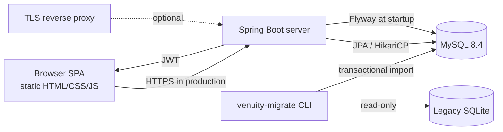

# Architecture

## Runtime shape

The server is a single Spring Boot JAR. It serves the SPA from
`venuity-server/src/main/resources/static` and exposes the modern `/api`
contract plus the legacy `/api/v1` contract used by the old React client.

The SPA is not built by npm. `index.html` loads the CSS, the application modules,
and the vendored Chart.js/jsQR files directly. The hash router uses
`#/dashboard`, `#/customers`, `#/recharge`, `#/scan`, `#/analytics` and
`#/settings`; login and the home screen are rendered by `app.js`.

## Modules

| Module | Responsibility |
|---|---|
| `venuity-common` | `MoneyUtil`, shared error codes |
| `venuity-server` | REST API, security, persistence, Flyway, SPA assets |
| `venuity-migrate` | SQLite reader, target preflight, import and reconciliation |
| `venuity-client` | Swing foundation retained for Phase 9 cleanup; not the supported UI |

## Backend layers

- `web/` controllers implement the modern API; `web/legacy/` implements the
  `/api/v1` compatibility contract.
- `service/` contains auth, wallet, check-in, customer, settings, analytics and
  idempotency logic.
- `repo/` contains Spring Data JPA repositories. Wallet mutations use pessimistic
  row locks (`SELECT ... FOR UPDATE`) before changing a balance.
- `domain/` contains the JPA entities. `security/` contains the JWT filter,
  password service, bootstrap admin runner and JSON error handlers.
- Flyway applies `V1__init.sql` and `V2__seed_settings.sql` at startup.

## Data model

| Table | Notes |
|---|---|
| `app_user` | ADMIN/STAFF roles, BCrypt hash, legacy PBKDF2 hashes rehashed on login |
| `business_settings` | Single row (`id = 1`), fee and branding settings |
| `customer` | Unique `public_id` and `public_code`, non-negative wallet balance, soft active flag |
| `wallet_transaction` | Append-only ledger; modern amounts are signed (top-up positive, check-in negative), `balance_after` is stored |
| `check_in` | One row per successful check-in, unique link to its wallet transaction |
| `idempotency_record` | Keyed by `(idem_key, endpoint, user_id)` with a request hash and cached response |

Important database invariants:

- `customer.wallet_balance >= 0` and `wallet_transaction.balance_after >= 0`.
- `business_settings` can only contain row `1`.
- `check_in.transaction_id` is unique.
- A wallet mutation and its ledger row commit in the same transaction.

## Authentication and authorization

1. `POST /api/auth/login` verifies the password. Legacy Django PBKDF2 hashes are
   accepted and rehashed to BCrypt on successful login.
2. The server returns an access JWT (8 hours by default) and a refresh JWT
   (7 days by default). The browser stores them under `venuity_access_token`
   and `venuity_refresh_token`.
3. `JwtAuthenticationFilter` validates the access token and exposes an
   `AuthPrincipal` with the user id and role.
4. ADMIN can edit settings and deactivate/reactivate customers. STAFF can read
   data and perform recharge/check-in. The legacy endpoints preserve the source
   role rules.
5. `POST /api/auth/refresh` rotates the pair; `POST /api/auth/logout` blacklists
   the refresh token. The blacklist is in memory, so a restart clears it.
6. Login attempts are rate-limited per IP and username.

## Money and idempotency

- Amounts are normalized with `BigDecimal` scale 2. The source range is
  `0.01` to `99,999,999.99` for recharge and the check-in fee is read from
  settings at call time.
- Recharge and check-in require an `Idempotency-Key` header. A replay with the
  same key, endpoint and user returns the cached response; a different payload
  with the same key is rejected.
- Check-in locks the customer row, verifies active status and sufficient balance,
  debits the wallet, writes the ledger row and then writes `check_in` in the same
  transaction. Insufficient balance returns HTTP 402 on the legacy contract and
  409 on the modern contract.

## Analytics

- The modern API exposes summary, daily and hourly endpoints. Revenue counts
  top-ups and opening balances; check-in count comes from check-in ledger rows.
- The legacy analytics endpoint preserves the source interval/metric contract
  and buckets timestamps in the configured business timezone (default
  `Asia/Kolkata`).
- Empty days/hours are returned as zero-filled points so charts have a stable
  shape.

## QR and browser scanning

- `GET /api/customers/{publicId}/qr.png` returns a PNG and requires Bearer auth.
  The SPA fetches it as a blob and displays an object URL.
- The server accepts both canonical dashed UUIDs and legacy 32-hex QR payloads
  when resolving a scan.
- The browser scanner uses `getUserMedia` and jsQR. Manual code entry is the
  tested fallback and is what automated tests exercise.

## Deployment

The normal production shape is a TLS-terminating reverse proxy in front of the
Spring Boot process. MySQL is a separate service. The optional Dockerfile and
Compose `server` profile package the JAR in a non-root container with a health
check. See `OPERATIONS.md` for run, backup and rotation details.
